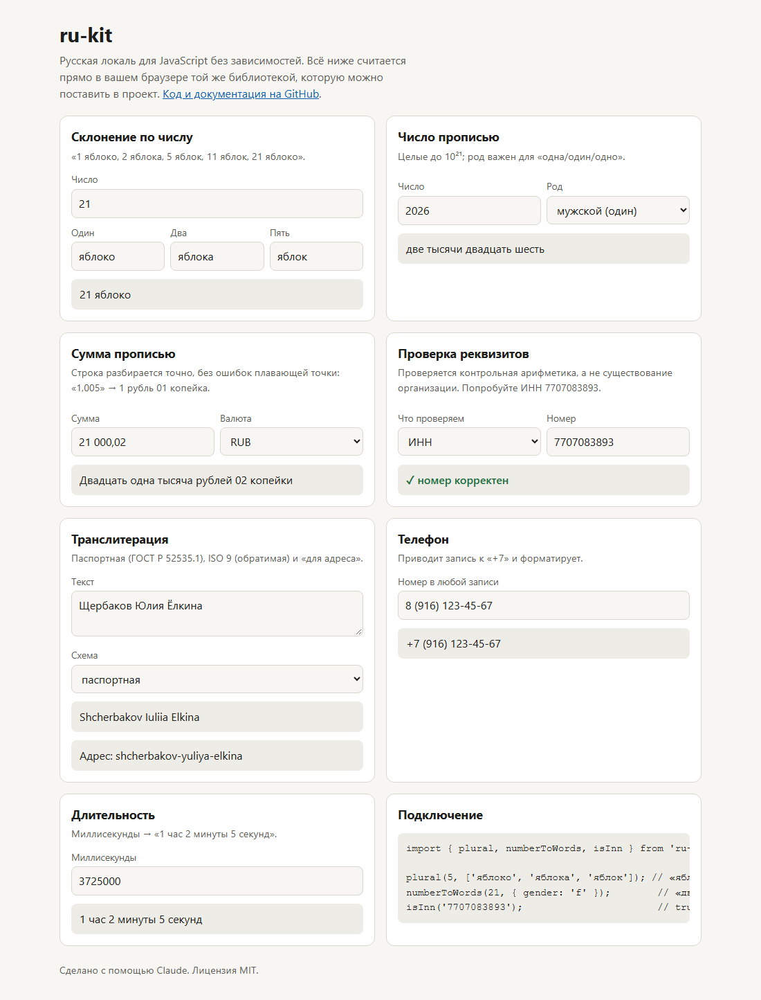

# ru-kit

[](https://github.com/Oleg4311/ru-kit/actions/workflows/ci.yml)
[Песочница](https://oleg4311.github.io/ru-kit/) · [Релизы](https://github.com/Oleg4311/ru-kit/releases)

**Русская локаль для JavaScript и TypeScript: без зависимостей, без сети, 11 КБ в пакете (вместе с README и типами).**
Числа и суммы прописью, правильная форма слова по числу, проверка контрольных разрядов ИНН/СНИЛС/ОГРН/БИК/счёта, транслитерация по ГОСТ, российские телефоны, длительности.



*English: a zero-dependency Russian-locale toolkit — plural forms, numbers and money in words, checksum validation of Russian tax/bank identifiers, GOST transliteration, phone normalization. See the [English section](#english).*

## Установка

Пакет пока не опубликован в npm (для этого нужен аккаунт npm), поэтому ставится из релиза GitHub:

```bash
npm install https://github.com/Oleg4311/ru-kit/releases/download/v0.1.0/ru-kit-0.1.0.tgz
```

Релиз содержит контрольную сумму и подтверждение происхождения сборки:

```bash
sha256sum -c SHA256SUMS
gh attestation verify ru-kit-0.1.0.tgz --repo Oleg4311/ru-kit
```

Требуется Node.js 22 или новее; в браузере работает любой современный (ES2022). Только ESM.

## Возможности

```ts
import { plural, count, numberToWords, amountInWords, isInn, normalizePhone, transliterate, humanizeDuration } from 'ru-kit';

plural(21, ['яблоко', 'яблока', 'яблок']);   // «яблоко»
count(1234567, ['рубль', 'рубля', 'рублей']); // «1 234 567 рублей» (с неразрывными пробелами)

numberToWords(2026);                     // «две тысячи двадцать шесть»
numberToWords(21, { gender: 'f' });      // «двадцать одна»
numberToWords(10n ** 18n);               // «один квинтиллион»

amountInWords('21 000,02');              // «двадцать одна тысяча рублей 02 копейки»
amountInWords('1.005');                  // «один рубль 01 копейка» (без ошибок float)
amountInWords('5', { currency: 'EUR' }); // «пять евро 00 центов»

isInn('7707083893');                     // true
isSnils('112-233-445 95');               // true
isOgrn('1027700132195');                 // true
isBankAccount('40702810138250123017', '044525225'); // true

normalizePhone('8 (916) 123-45-67');     // «+79161234567»
formatPhone('9161234567');               // «+7 (916) 123-45-67»

transliterate('Щербаков Юлия');          // «Shcherbakov Iuliia»  (паспортная, ГОСТ Р 52535.1)
transliterate('Щука', 'iso9');           // «Ŝuka»  (ISO 9, обратимая)
slugify('Привет, Мир! 2026');            // «privet-mir-2026»

humanizeDuration(3_725_000);             // «1 час 2 минуты 5 секунд»
relativeTime(Date.now() - 5 * 60_000);   // «5 минут назад»
```

## Что проверено

Это библиотека, где ошибка в одной форме слова видна пользователю, поэтому проверки сделаны не «на пару примеров»:

- **Склонение сверено с независимым эталоном.** Результат `plural` сравнивается с `Intl.PluralRules('ru')` для **каждого** целого от −2 000 до 100 000.
- **Числа прописью.** Таблица граничных значений (11–19, 21 000, 2 000 001, `Number.MAX_SAFE_INTEGER`, 10²¹ − 1), род, ошибки на дробных и слишком больших; ещё для всех чисел от 0 до 30 000 проверяется, что в строке нет двойных и краевых пробелов.
- **Реквизиты на настоящих номерах** (ИНН Сбербанка и Яндекса, ОГРН, расчётный счёт с БИК) и на искажениях: при замене любой одной цифры ИНН проверка отвергает больше 90 % вариантов. Границы СНИЛС: контрольные суммы 100, 101, 102 и 202.
- **ISO 9 обратима:** весь алфавит туда и обратно возвращается без потерь, один знак на знак.
- **Мутационная проверка:** убрали правило 11–14 в `plural`, род у «тысячи» и один из весов в ИНН — тесты падают (4, 10 и 1 тест).
- **Пакет проверен как у пользователя:** CI собирает tarball, ставит его в пустой проект и вызывает.
- **Песочница:** 20 браузерных тестов (десктоп и мобильный), в том числе доступность (axe) в светлой и тёмной теме и проверка, что введённая разметка выводится как текст.

## Честные ограничения

- **Только именительный падеж** для чисел прописью. Склонять «двадцать одну тысячу» по падежам библиотека не умеет.
- **Реквизиты проверяются арифметически.** `isInn(...) === true` означает «контрольная цифра сходится», а не «такая организация существует».
- **`amountInWords` для `number` округляет до двух знаков** через `toFixed(2)`, поэтому для точных денег передавайте строку (`'1.005'`).
- **Телефоны** — только российский план нумерации (+7); определения оператора или региона нет.
- **Не пакет npm**: см. раздел «Установка». Публикация в npm потребует аккаунта и trusted publishing.

## Разработка

```bash
npm ci
npm test          # 63 теста на node:test (Node 24 запускает .ts без сборки)
npm run typecheck
npm run build     # dist/index.js + типы
npm run site      # собрать песочницу в site/
npm run e2e       # браузерные тесты (Playwright + axe)
```

Песочница публикуется на GitHub Pages; после каждого деплоя workflow проверяет опубликованную версию (`release-receipt`, сверка коммита) и гоняет e2e уже на живом адресе.

Лицензия: MIT. Сделано с помощью Claude.

---

## English

**ru-kit** is a zero-dependency toolkit for Russian-language apps (ESM, Node ≥ 22, browsers).

- `plural(n, [one, few, many])` — correct noun form; verified against `Intl.PluralRules('ru')` for every integer in −2 000…100 000.
- `numberToWords`, `amountInWords` — numbers up to 10²¹ and money in words, with gender and exact string parsing (no float errors).
- `isInn`, `isSnils`, `isOgrn`, `isKpp`, `isBik`, `isBankAccount` — checksum validation of Russian tax and bank identifiers (arithmetic only; does not prove the entity exists).
- `transliterate` (passport GOST R 52535.1, reversible ISO 9, URL slug), `normalizePhone`/`formatPhone` (+7), `humanizeDuration`/`relativeTime`.

Not on npm yet: install from the GitHub release tarball (see above); releases carry SHA-256 sums and build provenance (`gh attestation verify`). Live playground: https://oleg4311.github.io/ru-kit/. MIT licensed. Built with Claude.
